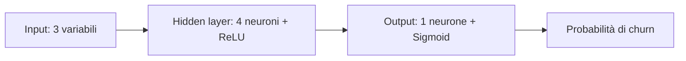
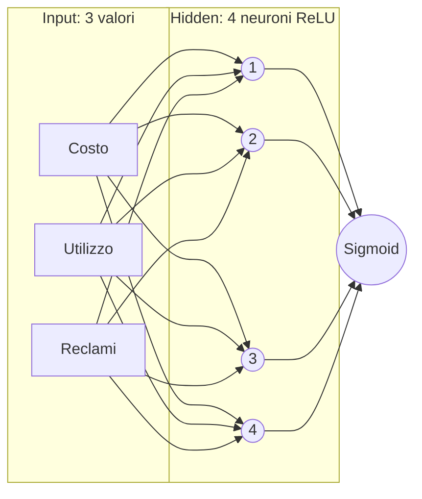
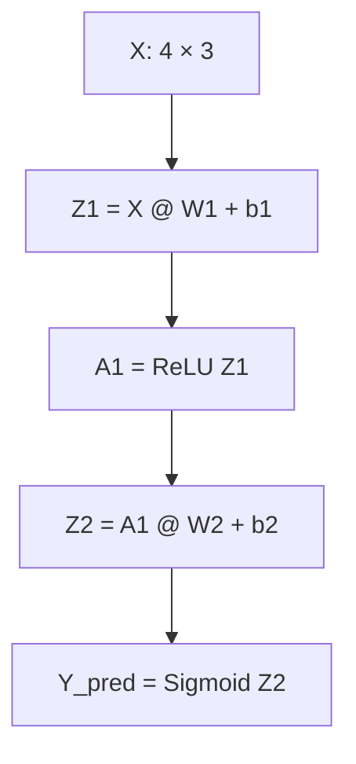
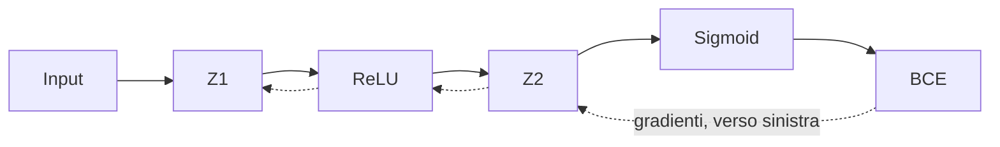
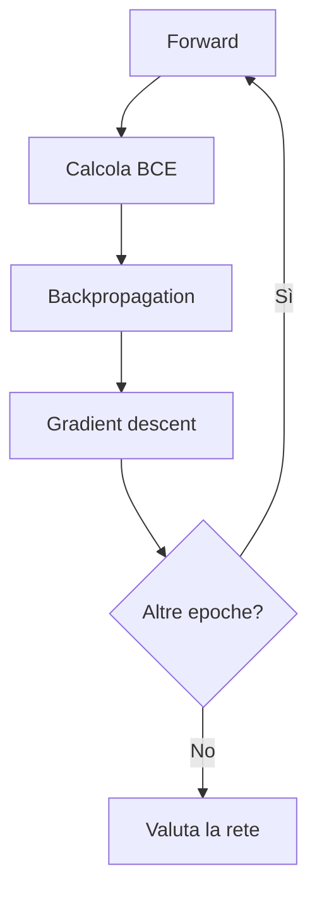
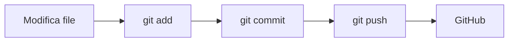

# Rete neurale da zero con Python e NumPy

> **Un progetto didattico, passo dopo passo, per comprendere davvero come una rete neurale impara.**
>
> Obiettivo: classificare clienti di un servizio in abbonamento in due categorie — **rimane (0)** oppure **abbandona (1)** — implementando manualmente i meccanismi fondamentali del deep learning, senza TensorFlow o PyTorch.

   

## Indice

1. [Perché questo progetto](#1-perché-questo-progetto)
2. [Che cos'è una rete neurale](#2-che-cosè-una-rete-neurale)
3. [Il problema: Customer Churn](#3-il-problema-customer-churn)
4. [Come installare ed eseguire il progetto](#4-come-installare-ed-eseguire-il-progetto)
5. [Come sono organizzati i file](#5-come-sono-organizzati-i-file)
6. [I dati: X e Y](#6-i-dati-x-e-y)
7. [Architettura e dimensioni delle matrici](#7-architettura-e-dimensioni-delle-matrici)
8. [Pesi, bias e inizializzazione](#8-pesi-bias-e-inizializzazione)
9. [Forward propagation](#9-forward-propagation)
10. [Perché serve ReLU](#10-perché-serve-relu)
11. [Sigmoid: dal logit alla probabilità](#11-sigmoid-dal-logit-alla-probabilità)
12. [Binary Cross-Entropy: misurare l'errore](#12-binary-cross-entropy-misurare-lerrore)
13. [Backpropagation e regola della catena](#13-backpropagation-e-regola-della-catena)
14. [Gradient descent e learning rate](#14-gradient-descent-e-learning-rate)
15. [Il training loop](#15-il-training-loop)
16. [Grafici e interpretazione dei risultati](#16-grafici-e-interpretazione-dei-risultati)
17. [Esempio numerico completo](#17-esempio-numerico-completo)
18. [Errori frequenti e risoluzione dei problemi](#18-errori-frequenti-e-risoluzione-dei-problemi)
19. [Git e GitHub: salvare i progressi](#19-git-e-github-salvare-i-progressi)
20. [Limiti, validazione e prossimi sviluppi](#20-limiti-validazione-e-prossimi-sviluppi)
21. [Glossario](#21-glossario)

---

## 1. Perché questo progetto

Molti tutorial mostrano come creare una rete neurale con poche righe di codice, delegando tutto a una libreria di alto livello. Qui facciamo il contrario: implementiamo **noi** i calcoli.

Al termine del percorso sapremo rispondere a domande come:

- Che cosa riceve un neurone?
- Che differenza c'è tra un **peso** e un **bias**?
- Perché la rete utilizza matrici NumPy?
- Perché i neuroni nascosti utilizzano **ReLU** e quello finale **Sigmoid**?
- Che cosa misura la **Binary Cross-Entropy**?
- Come fa la rete a sapere *quali pesi correggere*?
- Che differenza c'è tra **backpropagation** e **gradient descent**?
- Come verifichiamo se la rete impara davvero?

**Nota importante:** il dataset iniziale contiene soltanto quattro clienti inventati. Serve a capire e testare il codice, **non** a sviluppare un sistema credibile di previsione commerciale.

## 2. Che cos'è una rete neurale

Una rete neurale artificiale è una funzione matematica composta da operazioni successive. Riceve valori numerici, li trasforma tramite **pesi**, **bias** e **funzioni di attivazione**, e produce un risultato.

Il tipo che implementiamo è una **MLP (Multilayer Perceptron)**, cioè una rete *fully connected*: ogni neurone di un layer è collegato a tutti i neuroni del layer precedente.



**Non stiamo costruendo una CNN.** Le reti convoluzionali sono particolarmente adatte a sfruttare la struttura spaziale delle immagini; questa MLP lavora invece con caratteristiche tabellari, come costi, utilizzo e reclami.

## 3. Il problema: Customer Churn

*Churn* significa che un cliente interrompe il rapporto con un servizio, per esempio disdicendo un abbonamento.

Vogliamo stimare la probabilità che un cliente abbandoni il servizio usando tre caratteristiche:

| Input | Significato | Esempio |
|---|---|---|
| `x1` | Costo mensile | Valore alto = costo relativamente alto |
| `x2` | Frequenza di utilizzo | Valore alto = utilizzo frequente |
| `x3` | Numero di reclami | Valore alto = molti reclami |

Il risultato reale si chiama **etichetta** (*label*):

- `Y = 0`: il cliente rimane.
- `Y = 1`: il cliente abbandona.

Il modello non conosce automaticamente il significato delle colonne: lo sviluppatore deve costruire e documentare il dataset. I valori 0–1 di questo esperimento sono inventati e già scalati.

## 4. Come installare ed eseguire il progetto

### 4.1 Requisiti

- Python (consigliato 3.10 o superiore).
- Visual Studio Code con estensione Python.
- Git, se vuoi gestire le versioni.
- Pacchetti Python: `numpy`, `matplotlib`.

### 4.2 Preparazione su macOS

Apri il progetto in VS Code e apri **Terminal → New Terminal**. Poi, nella cartella del progetto:

```bash
python3 -m venv .venv
source .venv/bin/activate
python -m pip install numpy matplotlib
```

Se utilizzi Windows, l'attivazione in PowerShell è in genere:

```powershell
.venv\Scripts\Activate.ps1
```

Seleziona in VS Code **Python: Select Interpreter** e scegli l'interprete dentro `.venv`.

### 4.3 Verifica

```bash
python -c "import numpy as np; import matplotlib.pyplot as plt; print('Ambiente pronto', np.__version__)"
```

### 4.4 Esecuzione

I due script sono **indipendenti** nella versione didattica:

```bash
python main.py       # Studia un passaggio forward/backward
python training.py   # Ripete il training per più epoche
```

> Se `training.py` non è ancora stato creato o pubblicato sul tuo branch, il secondo comando non funzionerà: verifica i file presenti con `ls` oppure nell'Explorer di VS Code.

Per uscire dall'ambiente virtuale digita `deactivate`.

## 5. Come sono organizzati i file

```text
rete_neurale_1/
├── README.md          # Questa guida
├── main.py            # Calcoli studiati passo dopo passo
├── training.py        # Addestramento ripetuto (se già creato)
├── .gitignore         # File da non salvare in Git
└── .venv/             # Ambiente locale: NON va su GitHub
```

`main.py` aiuta a ispezionare matrici e gradienti; `training.py` esegue il ciclo completo. In questa fase **non importano codice l'uno dall'altro** e possono inizializzare reti separate. Anche usando lo stesso seed, ciò non significa che condividano pesi addestrati.

Un possibile `.gitignore`:

```gitignore
.venv/
__pycache__/
*.pyc
.env
.env.*
.DS_Store
data/
```

## 6. I dati: X e Y

Il nostro dataset iniziale:

```python
import numpy as np

X = np.array([
    [0.2, 0.8, 0.1],
    [0.9, 0.2, 0.7],
    [0.4, 0.6, 0.3],
    [0.7, 0.1, 0.9]
], dtype=np.float64)

Y = np.array([
    [0],
    [1],
    [0],
    [1]
], dtype=np.float64)

print(X.shape)  # (4, 3)
print(Y.shape)  # (4, 1)
```

Visualizziamo `X` come tabella:

| Cliente | Costo | Utilizzo | Reclami | Risposta Y |
|---|---:|---:|---:|---:|
| 1 | 0.2 | 0.8 | 0.1 | 0 |
| 2 | 0.9 | 0.2 | 0.7 | 1 |
| 3 | 0.4 | 0.6 | 0.3 | 0 |
| 4 | 0.7 | 0.1 | 0.9 | 1 |

**La forma `(4, 3)` significa 4 righe (clienti) e 3 colonne (caratteristiche).** In NumPy le forme sono fondamentali: una matrice può contenere gli stessi numeri, ma una disposizione diversa può rendere impossibile o errato un prodotto matriciale.

`Y` ha forma `(4, 1)` perché contiene una sola risposta per cliente.

### Perché usiamo più righe contemporaneamente?

NumPy consente di elaborare i quattro clienti con un'unica moltiplicazione matriciale, invece di scrivere un ciclo Python per ogni neurone di ogni cliente. Si chiama **vettorizzazione**.

## 7. Architettura e dimensioni delle matrici

La nostra rete ha 3 input, 4 neuroni nascosti e 1 neurone di output.



| Oggetto | Dimensione | Interpretazione |
|---|---|---|
| `X` | `(4, 3)` | 4 clienti × 3 caratteristiche |
| `W1` | `(3, 4)` | 3 pesi per ognuno dei 4 neuroni nascosti |
| `b1` | `(1, 4)` | 1 bias per neurone nascosto |
| `Z1` | `(4, 4)` | Predittore di ogni neurone per ogni cliente |
| `A1` | `(4, 4)` | Stessi risultati, trasformati con ReLU |
| `W2` | `(4, 1)` | 4 pesi del neurone finale |
| `b2` | `(1, 1)` | 1 bias finale |
| `Z2` | `(4, 1)` | Logit dei 4 clienti |
| `Y_pred` | `(4, 1)` | 4 probabilità |

**Numero totale di parametri addestrabili:**

- Hidden: `3 × 4 = 12` pesi e `4` bias.
- Output: `4 × 1 = 4` pesi e `1` bias.
- **Totale = 21 parametri.**

Attenzione: il numero di clienti **non cambia il numero dei pesi**. Se aggiungiamo 1.000 clienti, `X` diventa `(1000, 3)`, ma `W1` rimane `(3, 4)`.

## 8. Pesi, bias e inizializzazione

Ogni neurone calcola una **somma ponderata** degli input, più un bias:

$$
z = w_1 x_1 + w_2 x_2 + w_3 x_3 + b
$$

- **Peso (`w`)**: determina quanto una caratteristica contribuisce al predittore; può essere positivo o negativo.
- **Bias (`b`)**: aggiunge uno spostamento, consentendo al neurone di attivarsi a soglie diverse.
- **I pesi iniziali non sono ancora appresi**: saranno corretti dal training.

### 8.1 Seed: `np.random.default_rng(42)`

```python
rng = np.random.default_rng(42)
```

Il numero `42` è un **seed**: se inizializzi nuovamente lo stesso tipo di generatore con lo stesso seed e fai le stesse chiamate, ottieni gli stessi numeri pseudocasuali. Serve a riprodurre l'esperimento, **non** a rendere migliori le predizioni.

### 8.2 He Initialization

Il primo hidden layer utilizza ReLU. Perciò scegliamo una distribuzione dei pesi con varianza iniziale `2 / n_input`:

$$
W_{ij}\sim\mathcal N\left(0,\frac{2}{n_{input}}\right)
$$

La deviazione standard è quindi:

$$
\sigma = \sqrt{\frac{2}{n_{input}}}
$$

In codice:

```python
W1 = rng.standard_normal((3, 4)) * np.sqrt(2 / 3)
b1 = np.zeros((1, 4))
```

Perché? Se un neurone somma moltissimi contributi, pesi troppo grandi rischiano di far crescere eccessivamente la scala delle attivazioni. He adatta la scala iniziale al numero di connessioni in ingresso e compensa approssimativamente l'effetto della ReLU sotto determinate ipotesi statistiche.

| Numero di input | Scala He `sqrt(2/n)` |
|---:|---:|
| 3 | 0.8165 |
| 100 | 0.1414 |
| 1.000 | 0.0447 |

**Non confondere i ruoli:** He non sa quali input siano importanti, non riduce il rumore e non limita i pesi dopo l'inizializzazione. È il training che apprende i parametri.

### 8.3 Pesi dell'output

```python
W2 = rng.standard_normal((4, 1)) * np.sqrt(1 / 4)
b2 = np.zeros((1, 1))
```

Questa è una scelta iniziale con varianza `1 / fan_in` per il layer finale. La parola *Xavier* viene usata per diverse varianti: la forma classica Glorot utilizza `fan_in` e `fan_out`. Qui ci interessa soprattutto distinguere **inizializzazione** e **apprendimento**.

## 9. Forward propagation

La forward propagation è il passaggio dei dati dall'input all'output.



Il codice:

```python
Z1 = X @ W1 + b1
A1 = np.maximum(0, Z1)

Z2 = A1 @ W2 + b2
Y_pred = 1 / (1 + np.exp(-Z2))
```

**`@` è il prodotto matriciale**, non la moltiplicazione elemento per elemento (che in NumPy usa `*`).

Il primo prodotto ha forma `(4,3) @ (3,4) = (4,4)`.

Ogni **riga** di `Z1` è un cliente; ogni **colonna** è un neurone. La cella `Z1[0, 0]` contiene la risposta del primo neurone per il primo cliente.

`b1` con forma `(1,4)` viene sommato a ciascuna riga tramite **broadcasting**.

## 10. Perché serve ReLU

La funzione ReLU (*Rectified Linear Unit*) è:

$$
\operatorname{ReLU}(z)=\max(0,z)
$$

| z prima | ReLU(z) dopo |
|---:|---:|
| −2.0 | 0 |
| −0.3 | 0 |
| 0 | 0 |
| 0.8 | 0.8 |
| 2.0 | 2.0 |

**Un neurone attivo** è un neurone con output positivo dopo ReLU. **Un neurone inattivo** produce zero per quel particolare esempio; non viene eliminato dalla rete.

### 10.1 Perché la non linearità è essenziale?

Senza funzioni di attivazione, anche due layer consecutivi si possono ridurre a una sola trasformazione affine:

$$
W_2(W_1x+b_1)+b_2=(W_2W_1)x+(W_2b_1+b_2)
$$

Con ReLU, la formula cambia comportamento a seconda che ciascun predittore sia positivo o negativo. Combinando molti neuroni, la rete può rappresentare relazioni più complesse di una singola retta o di un solo piano.

Esempio: una tariffa potrebbe cambiare dopo tre ore:

$$
\operatorname{costo}(x)=10x+5+10\operatorname{ReLU}(x-3)
$$

Fino a tre ore la ReLU vale zero; oltre tre ore introduce un contributo aggiuntivo. Questo è un esempio di **funzione non lineare a tratti**.

**Importante:** ReLU **non è un filtro automatico dei dati inutili**. Può azzerare una risposta anche se gli input sono informativi; il significato dell'attivazione dipende da pesi, bias e addestramento.

## 11. Sigmoid: dal logit alla probabilità

L'ultimo neurone calcola `Z2`, chiamato anche **logit**. La funzione Sigmoid lo trasforma in un valore fra zero e uno:

$$
\sigma(z)=\frac{1}{1+e^{-z}}
$$

| Logit z | Sigmoid(z), circa |
|---:|---:|
| −2 | 0.119 |
| 0 | 0.500 |
| 2 | 0.881 |

Nel nostro problema `Y_pred = 0.8` significa **probabilità stimata di abbandono pari all'80%**. Non significa che il cliente abbia già abbandonato il servizio.

Esempio di implementazione con clipping numerico semplificato:

```python
def sigmoid(z):
    z = np.clip(z, -500, 500)
    return 1 / (1 + np.exp(-z))
```

La soglia `0.5` può essere usata per convertire una probabilità in classe, ma è una decisione separata dal calcolo probabilistico e non è sempre la soglia migliore.

## 12. Binary Cross-Entropy: misurare l'errore

Una predizione deve essere confrontata con la risposta reale `Y`. La **Binary Cross-Entropy (BCE)** misura quanto il modello penalizza la probabilità attribuita alla classe corretta.

Per un singolo cliente:

$$
L=-\left[y\log(\hat y)+(1-y)\log(1-\hat y)\right]
$$

- Se `y = 1`, diventa `-log(y_pred)`.
- Se `y = 0`, diventa `-log(1 - y_pred)`.

| Classe reale | Probabilità di churn stimata | BCE, circa | Interpretazione |
|---:|---:|---:|---|
| 1 | 0.90 | 0.105 | Corretta e convinta |
| 1 | 0.30 | 1.204 | Scarsa probabilità alla classe reale |
| 0 | 0.10 | 0.105 | Corretta e convinta |
| 0 | 0.80 | 1.609 | Sbagliata e convinta |

Per più clienti usiamo la **media** delle loss individuali. Una BCE di `0.76` **non è il 76% di errore**. È un valore logaritmico; nel dataset bilanciato una previsione costante pari a 0.5 produce circa `0.6931`, utile come semplice riferimento iniziale.

```python
def binary_cross_entropy(y_true, y_pred):
    eps = 1e-12
    p = np.clip(y_pred, eps, 1 - eps)
    return np.mean(-(y_true * np.log(p) + (1 - y_true) * np.log(1 - p)))
```

`np.clip` evita `log(0)`. In progetti più robusti si può calcolare la BCE direttamente dai logit, con formule numericamente stabili.

## 13. Backpropagation e regola della catena

La backpropagation calcola le derivate della loss rispetto ai parametri procedendo **all'indietro attraverso il grafo computazionale**.



**La backpropagation calcola i gradienti; non aggiorna da sola i pesi.** L'aggiornamento è compito dell'ottimizzatore, qui gradient descent.

Per capire la regola della catena, considera un peso del layer di output:

$$
\frac{\partial L}{\partial w}=\frac{\partial L}{\partial\hat y}\cdot\frac{\partial\hat y}{\partial z_2}\cdot\frac{\partial z_2}{\partial w}
$$

Con **Sigmoid + BCE**, per un esempio, la derivata rispetto al logit si semplifica a:

$$
\frac{\partial L}{\partial z_2}=\hat y-y
$$

Per la **loss media** su `m` clienti dividiamo il contributo per `m`.

### 13.1 Gradiente del layer di output

```python
m = X.shape[0]
dZ2 = (Y_pred - Y) / m
dW2 = A1.T @ dZ2
db2 = np.sum(dZ2, axis=0, keepdims=True)
```

### 13.2 Gradiente del layer nascosto

Per tornare al layer precedente applichiamo la regola della catena e la derivata della ReLU:

$$
\operatorname{ReLU}'(z)=\begin{cases}0 & z<0\\1 & z>0\end{cases}
$$

Nel punto `z = 0` scegliamo convenzionalmente zero per il calcolo.

```python
dA1 = dZ2 @ W2.T
dZ1 = dA1 * (Z1 > 0)
dW1 = X.T @ dZ1
db1 = np.sum(dZ1, axis=0, keepdims=True)
```

**Attenzione alle forme:**

| Gradiente | Forma |
|---|---|
| `dZ2` | `(4,1)` |
| `dW2` | `(4,1)` |
| `db2` | `(1,1)` |
| `dA1` / `dZ1` | `(4,4)` |
| `dW1` | `(3,4)` |
| `db1` | `(1,4)` |

Un neurone con ReLU inattiva non propaga un gradiente attraverso quella specifica attivazione per quell'esempio. Non significa che il modello abbia concluso che l'intera caratteristica sia inutile.

## 14. Gradient descent e learning rate

Una volta calcolati i gradienti, aggiorniamo i parametri nella direzione opposta al gradiente:

$$
w_{nuovo}=w_{vecchio}-\eta\frac{\partial L}{\partial w}
$$

`η` (eta) è il **learning rate**, cioè la dimensione del passo.

Esempio: peso `0.5`, gradiente `+0.8`, learning rate `0.1`:

$$
w_{nuovo}=0.5-0.1(0.8)=0.42
$$

- Gradiente positivo: il peso si riduce.
- Gradiente negativo: il peso aumenta.
- Gradiente zero: non cambia in quel passo.

Un gradiente zero **non garantisce** un minimo globale. L'obiettivo è ridurre la loss e generalizzare bene, non forzare artificialmente tutti i gradienti a zero.

```python
learning_rate = 0.1
W1 -= learning_rate * dW1
b1 -= learning_rate * db1
W2 -= learning_rate * dW2
b2 -= learning_rate * db2
```

**Ordine importante:** calcoliamo *tutti* i gradienti usando gli stessi pesi correnti e solo dopo aggiorniamo i parametri. Altrimenti rischiamo di mescolare pesi vecchi e nuovi nello stesso passo di backpropagation.

## 15. Il training loop

Il training ripete numerose volte il processo completo:



Un'**epoca** significa che l'algoritmo ha utilizzato una volta l'intero dataset di training. Nel nostro esempio, ciascuna epoca calcola un solo aggiornamento usando tutti e quattro i clienti: questo è **full-batch gradient descent**.

Ecco una versione completa e autonoma di `training.py`, coerente con il dataset didattico:

<details>
<summary><strong>Mostra il codice completo di training.py</strong></summary>

```python
import numpy as np
import matplotlib.pyplot as plt

# 1. Quattro esempi inventati
X = np.array([
    [0.2, 0.8, 0.1],
    [0.9, 0.2, 0.7],
    [0.4, 0.6, 0.3],
    [0.7, 0.1, 0.9],
], dtype=np.float64)

Y = np.array([[0], [1], [0], [1]], dtype=np.float64)

# 2. Pesi e bias
rng = np.random.default_rng(42)
W1 = rng.standard_normal((3, 4)) * np.sqrt(2 / 3)
b1 = np.zeros((1, 4))
W2 = rng.standard_normal((4, 1)) * np.sqrt(1 / 4)
b2 = np.zeros((1, 1))

# 3. Funzioni
def relu(z):
    return np.maximum(0, z)

def sigmoid(z):
    z = np.clip(z, -500, 500)
    return 1 / (1 + np.exp(-z))

def bce(y, p):
    eps = 1e-12
    p = np.clip(p, eps, 1 - eps)
    return np.mean(-(y * np.log(p) + (1 - y) * np.log(1 - p)))

# 4. Ciclo di training
learning_rate = 0.1
epochs = 1000
history = []

for epoch in range(epochs):
    # Forward
    Z1 = X @ W1 + b1
    A1 = relu(Z1)
    Z2 = A1 @ W2 + b2
    Y_pred = sigmoid(Z2)

    # Loss
    loss = bce(Y, Y_pred)
    history.append(loss)

    # Backward
    m = X.shape[0]
    dZ2 = (Y_pred - Y) / m
    dW2 = A1.T @ dZ2
    db2 = np.sum(dZ2, axis=0, keepdims=True)

    dA1 = dZ2 @ W2.T
    dZ1 = dA1 * (Z1 > 0)
    dW1 = X.T @ dZ1
    db1 = np.sum(dZ1, axis=0, keepdims=True)

    # Aggiorna soltanto dopo avere calcolato tutti i gradienti
    W1 -= learning_rate * dW1
    b1 -= learning_rate * db1
    W2 -= learning_rate * dW2
    b2 -= learning_rate * db2

    if epoch % 100 == 0:
        print(f"Epoch {epoch:4d} | BCE {loss:.6f}")

# 5. Previsioni finali, con gli ultimi pesi aggiornati
Z1 = X @ W1 + b1
A1 = relu(Z1)
Z2 = A1 @ W2 + b2
Y_pred = sigmoid(Z2)

print("\nBCE finale:", bce(Y, Y_pred))
print("Probabilità finali:\n", Y_pred)
print("Etichette reali:\n", Y)

# 6. Grafico
plt.figure(figsize=(9, 5))
plt.plot(history, label="BCE di training")
plt.xlabel("Epoca")
plt.ylabel("Binary Cross-Entropy")
plt.title("Andamento della loss")
plt.grid(True)
plt.legend()
plt.tight_layout()
plt.show()
```

</details>

**Nota:** il codice completo qui sopra è un riferimento didattico. Se i file locali sono già stati modificati, non sovrascriverli senza prima confrontarli e salvare le tue modifiche.

## 16. Grafici e interpretazione dei risultati

La variabile `history` contiene una BCE per ogni epoca. Per visualizzarla:

```python
plt.plot(history)
plt.xlabel("Epoca")
plt.ylabel("BCE")
plt.title("Loss durante il training")
plt.grid(True)
plt.show()
```

**Come leggere il grafico?**

- **Loss in discesa:** il modello sta riducendo l'obiettivo sul dataset di training.
- **Loss piatta:** potrebbe non apprendere, oppure avere già raggiunto un plateau.
- **Loss crescente o instabile:** potenziale learning rate troppo alto, instabilità numerica o errore nel codice.
- **Loss molto vicina a zero sui 4 clienti:** può significare semplicemente che la rete ha memorizzato gli esempi.

Non riportiamo grafici come risultati reali finché non vengono generati eseguendo effettivamente il training. I grafici futuri dovrebbero indicare chiaramente dataset, seed, numero di epoche e learning rate.

## 17. Esempio numerico completo

Per verificare il funzionamento di un neurone senza dipendere da valori casuali, scegliamo manualmente:

$$
x=[0.2,0.8,0.1],\quad w=[0.5,-0.3,0.7],\quad b=0
$$

Calcoliamo:

$$
z=(0.2)(0.5)+(0.8)(-0.3)+(0.1)(0.7)=-0.07
$$

Dopo ReLU:

$$
a=\max(0,-0.07)=0
$$

Questa attivazione sarà inviata al layer successivo come **zero**, ma il neurone rimarrà presente nella rete. Per un altro cliente lo stesso neurone, con gli stessi pesi, potrebbe produrre un'attivazione positiva.

Esempio del gradiente di un singolo peso di output per un cliente: se `y=1`, `y_pred=0.3` e l'attivazione precedente è `a=0.8`, allora:

$$
\frac{\partial L}{\partial w}=(0.3-1)(0.8)=-0.56
$$

Con learning rate `0.1`, il peso aumenta di `0.056` in un passo. Nel batch reale il gradiente viene mediato sui quattro clienti.

## 18. Errori frequenti e risoluzione dei problemi

| Problema | Possibile causa | Cosa controllare |
|---|---|---|
| `ModuleNotFoundError: numpy` | Pacchetto installato in un altro ambiente | Attiva `.venv`, seleziona l'interprete corretto e installa con `python -m pip install numpy` |
| `ModuleNotFoundError: matplotlib` | Matplotlib non installato | `python -m pip install matplotlib` |
| `ValueError: matmul ... mismatch` | Dimensioni incompatibili | Stampa `X.shape`, `W1.shape`, `A1.shape`, `W2.shape` |
| `NameError: W2` | Variabile non definita prima dell'uso | Controlla l'ordine delle istruzioni |
| `nan` nella loss | Probabilità estreme o instabilità numerica | Usa clipping e verifica learning rate/dati |
| Loss non scende | Gradiente errato, rete bloccata o learning rate inadatto | Verifica formule e gradienti; confronta predizioni iniziali/finali |
| `training.py` non compare su GitHub | Non è stato aggiunto/committato/pushato | `git status`, `git add training.py`, commit, push |
| `.venv` compare in Git | `.gitignore` non configurato o file già tracciati | Aggiungi `.venv/` a `.gitignore`; se già tracciata, rimuovila dall'indice Git |

### Due errori concettuali da evitare

**1. «ReLU elimina i dati inutili».** No: pone a zero le *attivazioni negative* di un neurone per un particolare esempio. Non misura direttamente l'importanza dell'input.

**2. «He crea pesi corretti».** No: He genera pesi **casuali con scala appropriata**. I pesi diventano utili solo attraverso il training.

## 19. Git e GitHub: salvare i progressi

**Git** gestisce le versioni sul computer. **GitHub** ospita il repository remoto. Un `commit` salva localmente; un `push` invia i commit a GitHub.



Dopo aver verificato che tutto funzioni:

```bash
git status
git add README.md main.py training.py
git commit -m "Document neural network from scratch"
git push
```

Se `training.py` non esiste, omettilo dal comando `git add`.

Per controllare il collegamento remoto:

```bash
git remote -v
```

Per visualizzare la cronologia:

```bash
git log --oneline
```

**Suggerimento:** crea commit piccoli e descrittivi quando completi una funzionalità: inizializzazione, forward, BCE, backward, training, grafici. Evita di caricare dataset privati, password, token o l'ambiente virtuale.

## 20. Limiti, validazione e prossimi sviluppi

### Limiti attuali

Il nostro esempio è volutamente minimale:

1. I quattro clienti sono inventati, non una rappresentazione statistica del mercato.
2. Con quattro esempi, il modello può adattarsi ai dati senza imparare una regola che generalizzi.
3. Il grafico della BCE di training non dimostra accuratezza su dati nuovi.
4. I pesi dipendono dal seed, dall'architettura e dagli iperparametri.
5. Una previsione di churn è una **stima**, non una certezza o una prova di causalità.

### Roadmap futura

- **Dataset reale:** usare un dataset pubblico come IBM Telco Customer Churn.
- **Pulizia e preprocessing:** valori mancanti, variabili categoriche, standardizzazione.
- **Split corretto:** training, validation e test, evitando data leakage.
- **Baseline:** confrontare l'MLP con una regressione logistica.
- **Metriche:** accuracy, precision, recall, F1, matrice di confusione, ROC-AUC; controllare anche la calibrazione delle probabilità.
- **Overfitting:** monitorare training e validation loss, considerare regolarizzazione ed early stopping.
- **Salvataggio del modello:** esportare pesi e bias addestrati, con metadati di preprocessing.
- **Refactoring:** spostare le funzioni condivise in `neural_network.py`, evitando duplicazioni tra `main.py` e `training.py`.

Una rete neurale più complessa **non è automaticamente migliore** di un modello più semplice: bisogna misurarlo sui dati di validazione e test.

## 21. Glossario

| Termine | Definizione semplice |
|---|---|
| **Feature** | Variabile di input che descrive un esempio |
| **Label** | Risposta reale da imparare a prevedere |
| **Dataset** | Insieme organizzato di esempi |
| **Tensore** | Struttura numerica multidimensionale; una matrice è un tensore di ordine 2 |
| **Peso** | Coefficiente che moltiplica un input o un'attivazione |
| **Bias** | Termine aggiuntivo nel predittore |
| **Layer** | Gruppo di neuroni o trasformazione nella rete |
| **Hidden layer** | Layer intermedio tra input e output |
| **Logit** | Valore del predittore prima della Sigmoid |
| **Attivazione** | Valore prodotto dalla funzione di attivazione |
| **ReLU** | `max(0,z)`; introduce non linearità |
| **Sigmoid** | Converte un logit in un numero fra 0 e 1 |
| **BCE** | Funzione di perdita per classificazione binaria |
| **Forward propagation** | Calcolo di output e predizioni |
| **Backpropagation** | Calcolo dei gradienti lungo il grafo, a ritroso |
| **Gradiente** | Sensibilità locale della loss rispetto a un parametro |
| **Gradient descent** | Algoritmo che aggiorna i parametri usando i gradienti |
| **Learning rate** | Dimensione del passo di aggiornamento |
| **Epoca** | Un passaggio completo sui dati di training |
| **Seed** | Valore per rendere riproducibile una sequenza pseudocasuale |
| **He Initialization** | Scala iniziale dei pesi particolarmente adatta ai layer ReLU |
| **Overfitting** | Ottimo adattamento al training ma scarse prestazioni su dati nuovi |
| **Commit** | Versione registrata nella storia Git locale |
| **Push** | Invio dei commit al repository remoto |

---

### Riferimenti per approfondire

- [Documentazione NumPy](https://numpy.org/doc/stable/)
- [Documentazione Matplotlib](https://matplotlib.org/stable/)
- [Guida Python in VS Code](https://code.visualstudio.com/docs/python/python-tutorial)
- [Git: documentazione ufficiale](https://git-scm.com/doc)
- [GitHub Docs](https://docs.github.com/)
- Kaiming He et al. (2015), *Delving Deep into Rectifiers: Surpassing Human-Level Performance on ImageNet Classification* — inizializzazione He.
- Diederik P. Kingma e Jimmy Ba (2014), *Adam: A Method for Stochastic Optimization* — approfondimento futuro sugli ottimizzatori.

**Stato:** progetto educativo in sviluppo. I risultati ottenuti sui quattro esempi non vanno interpretati come prestazioni su clienti reali.
